  

### Hi, I'm Eduardo 👋

A backend and cloud engineer from Mexico City who never stopped playing with cellular automata.

By day I build event-driven backends on AWS and apps that talk to hardware over BLE and USB.
By night (and for my thesis) I let a slime mold, *Physarum polycephalum*, find its way through caves
and catacombs. We published that at CANDAR 2024, in Okinawa. 🦠

**[Open my CV](https://isgarcia-zero.github.io/)** · [English version](https://isgarcia-zero.github.io/?lang=en) ·
[LinkedIn](https://www.linkedin.com/in/eduardo-hernandez-vergara-369366246) ·
[eduardo.hernandezv@proton.me](mailto:eduardo.hernandezv@proton.me)

### 🧬 Things I like building

- **Backends that don't lose messages.** Go and Java microservices on AWS SQS, S3 and CloudTrail
  events, NATS in between, Kubernetes on Azure. About 10,000 messages a day, idempotent and retried.
  I even rewrote one pipeline from Java to C++20 (~30k lines) without breaking a single contract.
- **Apps that talk to hardware.** Eight WPF and WinForms apps turned into one Avalonia codebase for
  desktop and mobile; a BLE device manager with mesh provisioning, CBOR and firmware over the air
  (~400 tests); a Flutter field app on Android and iOS; and a key-provisioning app rewritten in pure F#.
- **Tiny rules, huge behavior.** All 256 Wolfram rules, the Game of Life, traffic simulated with rule 184,
  and a robot that follows paths drawn by a slime-mold automaton.

### 🎮 Play with my CV

It isn't a PDF: it's an F# app (Bolero + Blazor WebAssembly) with a small automata lab.
Drop ants on Langton's grid, watch Brian's Brain and Wireworld, then select any text and rule 30
will run inside your selection. Psst: type `life` anywhere on the page.

### 📌 Public projects

| | Repository | What it is |
| --- | --- | --- |
| 🌐 | [cv-web-fs](https://github.com/IsGarcia-zero/cv-web-fs) | My CV in F# (Bolero, Blazor WebAssembly, MVU), prerendered, with ATS-friendly PDFs per role |
| 🦠 | [Physarum-Automata](https://github.com/Jessenox/Physarum-Automata) | Thesis simulation (co-authored): Physarum with cellular automata, C++, later Vulkan compute shaders |
| 🔺 | [cellularAutomataECARules](https://github.com/IsGarcia-zero/cellularAutomataECARules) | All 256 elementary rules: density, attractors, graphs, auto-generated LaTeX reports |
| 🛸 | [juegoDeLaVida](https://github.com/IsGarcia-zero/juegoDeLaVida) | Conway's Game of Life with configurable rules, population charts and attractors |
| 🚦 | [traficoControlECARules](https://github.com/IsGarcia-zero/traficoControlECARules) | An intersection where cars follow rule 184 |
| 🤖 | [Teoria-Computacional](https://github.com/IsGarcia-zero/Teoria-Computacional) | DFA, NFA, pushdown automaton and a Turing machine |

Most of my day-to-day work lives in private repositories, so this is the fun part. 🙂

### 🛠️ Stack

Go · C# / .NET · F# · C++20 · Java · TypeScript · AWS · Kubernetes · NATS · PostgreSQL · Avalonia · Flutter

🇲🇽 Spanish (native) · 🇬🇧 English (B2) · 🇯🇵 Japanese (A2)

---

Nothing above is hand-drawn: the banner is Conway's Game of Life (B3/S23), the strip is rule 30,
and this glider loops around a tiny torus. They come out of <a href="assets/automata.py">a small script</a> that runs the real rules.
